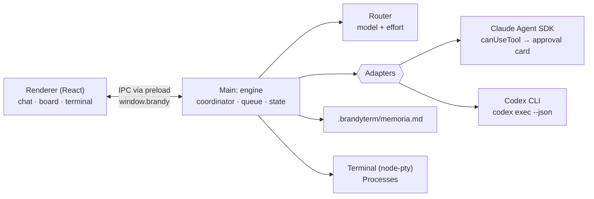

<p align="center">
  
</p>

<h1 align="center">BrandyTerm</h1>

<p align="center">
  <strong>A desktop terminal for multi-agent orchestration of AI coding agents.</strong><br>
  Run <strong>Claude Code</strong> and <strong>Codex</strong> side by side: one coordinator per project delegates work to agent threads,
  tracks them on a kanban board and asks you before anything risky runs. Built with Electron, React and TypeScript.
</p>

<p align="center">
  <strong>English</strong> · <a href="README.pt-BR.md">Português (Brasil)</a>
</p>

<p align="center">
  <a href="LICENSE"></a>
  
  
  
  <a href="https://github.com/ebrandes/brandyTerm/stargazers"></a>
</p>

<p align="center">
  
</p>

> **Early version (0.1).** The interface is currently in Brazilian Portuguese. Expect rough edges.

## Table of contents

- [Features](#features)
- [Screenshots](#screenshots)
- [Requirements](#requirements)
- [Install and run](#install-and-run)
- [Architecture](#architecture)
- [Roadmap](#roadmap)
- [Contributing](#contributing)
- [License](#license)
- [Support](#support)

## Features

**Coordinator and agent threads**

- **One coordinator chat per project.** Open any folder as a project. The coordinator either answers directly or splits the request into up to 3 tasks, choosing the agent, model and effort for each one and explaining why. It only plans for CLIs that are actually installed.
- **Agent threads.** Each delegated task runs as a thread with a live plan (task list), collapsible tool actions and a short final answer that reports back to the main chat. You can also open a thread and talk to it directly.
- **Automatic model routing.** A quick classification call sorts each task into a light, standard or heavy tier, which sets the model and effort.
- **Concurrency and context limits.** Up to 2 threads run at once per project; the rest wait in a queue. Thread context auto-compacts at 120k tokens.
- **Project memory.** Each project keeps a short `.brandyterm/memoria.md` with context, decisions and a map of the code. The coordinator reads it on every message and threads read it before starting; it is compacted automatically when it grows.

**Control and safety**

- **Approvals before risky actions.** Claude threads run through the Claude Agent SDK. Read-only tools are pre-allowed; anything else (a shell command that changes something, a file edit, web access) stops and shows an approval card. Allow once, always allow that command family, or allow everything for the thread.
- **Questions as cards.** When a thread needs a decision it moves to *Waiting for you* and shows the options as a card in the main chat. Answering there, or telling the coordinator, resumes it.
- **Sandboxed Codex.** Codex threads run `codex exec` with its own sandbox: writes only inside the project folder and no network.
- **No bypass flags.** Prompts go over stdin, your global Claude hooks and MCP servers stay out of threads, and plugins are scanned before they load.

**Workspace**

- **Kanban board of agents.** Columns for *Queued*, *Running*, *Waiting for you*, *Done* and *Failed / cancelled*. Finished columns show the 10 most recent cards with *Show more*; threads older than 7 days, or beyond the 50 most recent per project, move to an archive you can reopen. Nothing is deleted.
- **Attachments.** Paste, drop or pick up to 12 files (25 MB each). Images can be marked up before sending (pen, box, arrow, numbered pins) and are passed to both Claude and Codex.
- **`@` file mentions and `/` commands.** Type `@` to autocomplete project files (respects `.gitignore`). Type `/` for `/clear`, `/compact`, `/help` and the commands from your Claude plugins.
- **Integrated terminal.** One real shell per project (xterm.js + node-pty), opened in the project folder.
- **Processes panel.** Start dev servers and other long-running commands from the UI. Ports printed in the output become clickable chips, logs are kept, and everything is stopped when the app quits. Threads never start processes.
- **Multiple Claude accounts.** Add extra accounts with `claude setup-token`; tokens are encrypted with the OS keychain. BrandyTerm can switch accounts automatically before a rate limit stops a run.
- **Claude plugins and skills.** A few plugins pinned to a commit are fetched on install ([Superpowers](https://github.com/obra/superpowers), [TokenEconomizer](https://github.com/microsoft/TokenEconomizer) and two from [anthropics/claude-plugins-official](https://github.com/anthropics/claude-plugins-official)). Each project picks its skills and plugins in the sidebar's Skills panel; the choice is saved in `.brandyterm/skills.json`, so it travels with the project's git. `/skill-init`, `/skill-refresh` and `/skill-install` suggest, update and import items from a skills library (a git repo, `ebrandes/claude-kit` by default, set at the bottom of the panel). Optional [RTK](https://github.com/rtk-ai/rtk) support compresses shell output for threads.
- **Token and context footer.** See the coordinator's context use and the tokens spent per project.

## Screenshots

**Kanban board of agents.** Every thread of the project, by state: queued, running, waiting for you, done, failed or cancelled.

<p align="center">
  
</p>

**Agent thread with an approval card.** The thread's plan, its actions and a shell command waiting for your approval.

<p align="center">
  
</p>

**Coordinator chat.** The coordinator splits a request into threads, explains its choice of agent and model, and brings a thread's question back as a card.

<p align="center">
  
</p>

The screenshots use a demo project with fake data. A demo GIF is coming; see [`docs/assets/README.md`](docs/assets/README.md).

## Requirements

- **macOS.** This is where BrandyTerm is developed and tested. Windows is also checked by CI (see [Run on Windows](#run-on-windows)) but is not tested in depth yet.
- **Node.js 22+** and npm.
- **Git**, used on `npm install` to fetch the bundled Claude plugins.
- At least one agent CLI, installed and logged in:
  - **[Claude Code CLI](https://docs.anthropic.com/en/docs/claude-code)** (`claude`). Run `claude` once and log in.
  - **[Codex CLI](https://github.com/openai/codex)** (`codex`). Run `codex` once and log in.

Antigravity (`agy`) is detected but not wired yet.

## Install and run

```bash
git clone https://github.com/ebrandes/brandyTerm.git
cd brandyTerm
npm install          # also runs postinstall: fetches the pinned Claude plugins into resources/plugins
npm run dev          # starts the app in development mode (predev updates the Claude Agent SDK)
```

Other scripts from `package.json`:

| Command | What it does |
| --- | --- |
| `npm run build` | Builds main, preload and renderer into `out/` with electron-vite |
| `npm run preview` | Runs the built app from `out/` |
| `npm run typecheck` | Type-checks the whole project (`tsc --noEmit`) |
| `npm run plugins` | Fetches the pinned Claude plugins again |

App state (projects, threads, settings, attachments and the thread archive) lives in the Electron user data folder, `~/Library/Application Support/brandyterm` on macOS.

## Run on Windows

CI runs typecheck, tests and build on Windows on every push. To use the app:

```powershell
git clone https://github.com/ebrandes/brandyTerm.git
cd brandyTerm
npm ci
npm run dev
```

Node.js and Git must be on PATH, and the agent CLI (`claude` and/or `codex`) installed and logged in. When **Acesso remoto** (remote access) is on, Windows shows a firewall prompt the first time: allow access on **private networks**.

## Architecture

BrandyTerm is a standard Electron app built with [electron-vite](https://electron-vite.org):

- **`src/main`** (main process, Node.js). The **engine** (`engine.ts`) runs the coordinator, queues and settles threads, and keeps the state. **Adapters** (`src/main/adapters/`) give every agent the same interface: `claude` (Claude Agent SDK, with `canUseTool` for approvals), `codex` (`codex exec --json`) and an `antigravity` stub. Around them: approvals and allow rules, project memory, the router, attachments, the archive, the terminal (node-pty) and the processes panel.
- **`src/preload`**. A small `contextBridge` API (`window.brandy`) over IPC. The renderer has no direct Node access.
- **`src/renderer`** (React 18). Chat, composer with `@` and `/` menus, thread view, kanban board, approval cards, terminal (xterm.js), processes and accounts panels.
- **`src/shared`**. Types and the API contract shared by both sides.



## Roadmap

- [ ] **Packaged app**: `.app`/`.dmg` builds with electron-builder, using the icon in `build/` (`icon.icns`).
- [ ] **Antigravity** adapter (`agy` headless).
- [ ] **Codex plan view**: `codex exec` does not emit a plan, so Codex threads show actions only for now.
- [ ] **Archive follow-ups**: open archived threads from chat chips, run retention while the app is open (today it runs at startup).
- [ ] **SQLite state** instead of a single JSON file.
- [ ] **English UI** and Windows support.

Ideas and votes are welcome in [issues](https://github.com/ebrandes/brandyTerm/issues).

## Contributing

Contributions are welcome.

1. Open an issue first for anything bigger than a small fix, so we can agree on the approach.
2. Fork, create a branch from `main`, and keep changes focused.
3. Run `npm run typecheck` before opening a pull request.
4. Keep source files under 400 lines: split by responsibility instead of growing a file.
5. Never commit tokens, personal paths or screenshots with private data.

## License

[MIT](LICENSE) © BrandyTerm contributors.

BrandyTerm is an independent project and is not affiliated with Anthropic or OpenAI. Claude, Claude Code and Codex are trademarks of their respective owners.

## Support

<p align="center">
  <br>
  <strong>If BrandyTerm saves you time, please <a href="https://github.com/ebrandes/brandyTerm">⭐ star this repo</a>.</strong><br>
  It helps other developers find it.
</p>

<p align="center">
  <a href="https://www.buymeacoffee.com/ebrandes"></a>
</p>

<a href="https://star-history.com/#ebrandes/brandyTerm&Date">
  <picture>
    <source media="(prefers-color-scheme: dark)" srcset="https://api.star-history.com/svg?repos=ebrandes/brandyTerm&type=Date&theme=dark">
    
  </picture>
</a>
