<p align="center">
  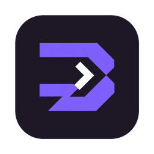
</p>

<h1 align="center">BrandyTerm</h1>

<p align="center">
  <strong>A desktop terminal for multi-agent orchestration of AI coding agents.</strong><br>
  Run <strong>Claude Code</strong> and <strong>Codex</strong> side by side on macOS and Windows: one AI coordinator per project delegates coding tasks to agent threads,
  tracks them on a kanban board and asks for approval before risky actions, with MCP connectors and token usage reports. Built with Electron, React and TypeScript.
</p>

<p align="center">
  <strong>English</strong> · <a href="README.pt-BR.md">Português (Brasil)</a>
</p>

<p align="center">
  <a href="LICENSE"></a>
  
  
  
  <a href="https://github.com/ebrandes/brandyTerm/stargazers"></a>
</p>

<p align="center">
  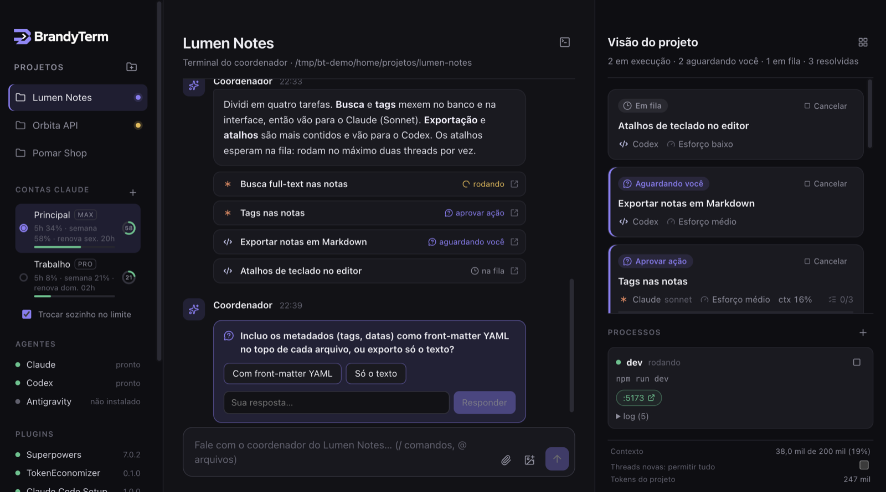
</p>

> **Early version (0.1).** The interface is currently in Brazilian Portuguese. Expect rough edges.

## Table of contents

- [Features](#features)
- [Screenshots](#screenshots)
- [Requirements](#requirements)
- [Install and run](#install-and-run)
- [Architecture](#architecture)
- [Roadmap](#roadmap)
- [Contributing](#contributing)
- [License](#license)
- [Support](#support)

## Features

### Coordinator and agent threads

- **One coordinator chat per project.** Open any folder as a project. The coordinator either answers directly or splits the request into up to 3 tasks, choosing the agent, model and effort for each one and explaining why. It only plans for CLIs that are actually installed. It can also answer a waiting thread, ask a thread something, resume interrupted threads, and it summarizes the results at the end.
- **Claude Code and Codex agent threads.** Each delegated task runs as a thread with a live plan (task list), collapsible tool actions and a short final answer that reports back to the main chat. You can also open a thread and talk to it directly.
- **Automatic model routing.** The coordinator names a light, standard or heavy tier for each task (a quick Haiku call classifies it only if the tier is missing). For Claude, the tier sets the model and effort, and heavy tasks plan with a stronger model before executing; for Codex it sets the effort. Prefixes such as `!haiku`, `!sonnet`, `!opus` or `!plano` at the start of a message override the choice.
- **Concurrency and context limits.** Up to 2 threads run at once per project; the rest wait in a queue. Thread and coordinator context auto-compacts, and an idle coordinator with a large context can be compacted to save tokens.
- **Project memory.** Each project keeps a short `.brandyterm/memoria.md` with context, decisions and a map of the code. The coordinator reads it on every message and threads read it before starting; it is compacted automatically when it grows.

### Questions, status and notifications

- **Thread questions with a stepper.** When a thread needs decisions it moves to *Waiting for you* and shows a card in the thread and in the main chat. Several questions appear one at a time (*1 de N*) with clickable options, the recommended one highlighted, and a free-text answer; all answers are sent together. Answering in either place, or telling the coordinator, resumes the thread.
- **Status per project.** In the sidebar, a spinner means something is running, an amber dot means a thread is waiting for you, and an accent-colored dot means there is news you have not seen. Hover for the counts.
- **Native notifications.** When a thread or the coordinator finishes, fails or needs an answer, you get a system notification with the project name and the thread title (no conversation content). Clicking it opens that place. It stays quiet if you are already looking at it, and you can turn it off.

### Control and safety

- **Approvals before risky actions.** Claude threads run through the Claude Agent SDK. Read-only tools are pre-allowed; anything else (a shell command that changes something, a file edit, web access) stops and shows an approval card. Allow once, always allow that command family, or allow everything for the thread. An opt-in setting lets new threads run without asking; it is off by default.
- **Worktree apply queue.** A thread that worked in a git worktree can ask to apply its commit to the project folder. Requests show up in the **Aplicações** (applications) panel in the sidebar. You approve each one once; BrandyTerm then applies them one at a time, in order, when nothing is running in any project. The patch is fixed at the moment of the request, checked with `git apply --check`, applied all-or-nothing and never committed. A failed request holds the queue until you retry or discard it.
- **Sandboxed Codex.** Codex work threads run `codex exec` with its own sandbox: writes only inside the project folder and no network.
- **No bypass flags.** Prompts go over stdin, your global Claude hooks and MCP servers stay out of threads, and plugins are scanned before they load.

### MCP connectors

- **Global and per-project connectors.** The **Conectores** (connectors) panel adds MCP servers once and lets you choose where they are active: every project, including new ones, with exceptions, or only the projects you check. Claude and Codex work threads reach them through a BrandyTerm MCP gateway.
- **Presets and custom servers.** Presets: Railway, GitHub, Stripe, Supabase, Sentry and Chrome DevTools. Any other server can be added by URL or command, for example [Context7](https://context7.com) (`https://mcp.context7.com/mcp`). Pasting a `claude mcp add` or `codex mcp add` command is recognized and converted, and you can import from Claude Code.
- **Approvals and secrets.** Connector tool calls from threads show an approval card (deny, once or always for that tool) unless already allowed. Secrets are encrypted with the OS keychain.
- **Logs with a summary.** **Ver logs** (view logs) shows a short summary of the log written by Claude Haiku, errors first, with search, a level filter and a button to reveal the file. The summary is requested only while the window is open; secrets are redacted when entries are written.

### Token economy

- **TokenEconomizer and RTK.** [TokenEconomizer](https://github.com/microsoft/TokenEconomizer) and optional [RTK](https://github.com/rtk-ai/rtk) support, which compresses shell output, are passed to each run without changing your user settings. For Codex they need Codex CLI 0.171.0 or newer; TokenEconomizer needs Python 3.10+.
- **Monthly usage report.** **Consumo do mês** (this month's usage) shows quality by tier (finished, rework, replacements, corrections, escalations, tokens per resolved task) against the previous month; usage per project, agent, model and kind of call (Codex does not report cost); and per-tool savings, with an RTK estimate and a comparison of threads with and without each tool. It only calls something a gain when there is enough data and quality did not get worse.
- **Token and context footer.** See the coordinator's context use and the tokens spent per project.

### Workspace

- **Kanban board of agents.** Columns for *Queued*, *Running*, *Waiting for you*, *Done* and *Failed / cancelled*. Finished columns show the 10 most recent cards with *Show more*.
- **Thread archive.** Finished threads older than 7 days, or beyond the 50 most recent per project, move to an archive you can reopen. Retention runs at startup and nothing is deleted.
- **Process panel.** **PROCESSOS** lists detected processes, whether they came from the terminal, from a thread or were already running, with PID, folder, uptime, full command and clickable port chips. Filters hide noise such as the app itself, the agents, MCP servers and hooks. A stop button, with confirmation, stops a process and its children. You can also start dev servers from the panel; their logs are kept and they are stopped when the app quits. The panel can be minimized.
- **Project right-click menu.** Rename (display name only), archive and restore, clear the coordinator context, open in Finder or File Explorer, copy the path, or remove the project from BrandyTerm. The folder is never deleted.
- **Attachments.** Paste, drop or pick up to 12 files (25 MB each). Images can be marked up before sending (pen, box, arrow, numbered pins) and are passed to both Claude and Codex.
- **`@` file mentions and `/` commands.** Type `@` to autocomplete project files (respects `.gitignore`). Type `/` for `/clear`, `/compact`, `/help` and the commands from your Claude plugins.
- **Integrated terminal.** One real shell per project (xterm.js + node-pty), opened in the project folder.
- **Multiple Claude accounts.** Add extra accounts with `claude setup-token`; tokens are encrypted with the OS keychain. BrandyTerm can switch accounts automatically before a rate limit stops a run.
- **Claude plugins and skills.** A few plugins pinned to a commit are fetched on install ([Superpowers](https://github.com/obra/superpowers), [TokenEconomizer](https://github.com/microsoft/TokenEconomizer) and two from [anthropics/claude-plugins-official](https://github.com/anthropics/claude-plugins-official)). Each project picks its skills and plugins in the sidebar's Skills panel; the choice is saved in `.brandyterm/skills.json`, so it travels with the project's git. `/skill-init`, `/skill-refresh` and `/skill-install` suggest, update and import items from a skills library (a git repo, `ebrandes/claude-kit` by default, set at the bottom of the panel).
- **Remote access on the local network.** Off by default. Pair other computers and choose which projects are available to them.
- **Version and update notice.** The version appears next to the logo. BrandyTerm checks at startup and every 6 hours for a newer GitHub release or, in a git clone, new commits on `origin/main`. It never installs anything: it opens the release page or shows the `git pull` command to copy.

## Screenshots

**Kanban board of agents.** Every thread of the project, by state: queued, running, waiting for you, done, failed or cancelled.

<p align="center">
  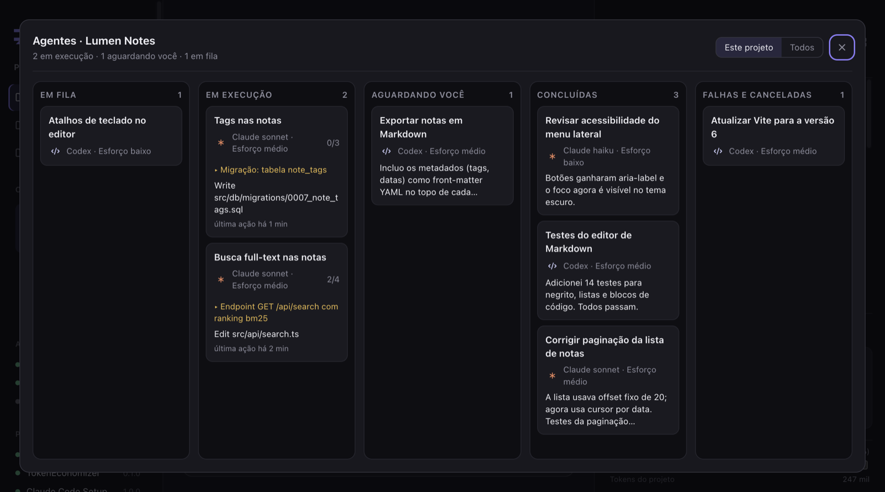
</p>

**Agent thread with an approval card.** The thread's plan, its actions and a shell command waiting for your approval.

<p align="center">
  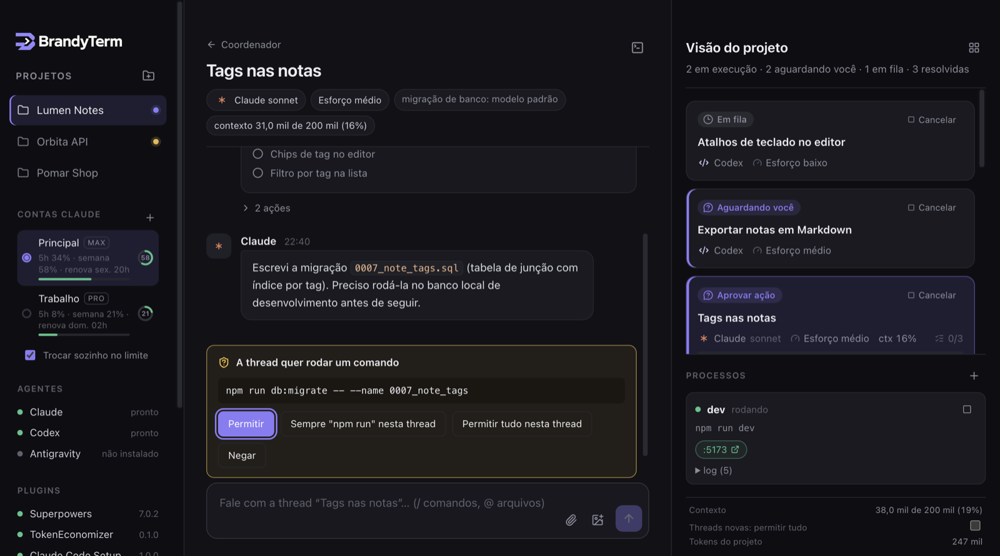
</p>

**Coordinator chat.** The coordinator splits a request into threads, explains its choice of agent and model, and brings a thread's question back as a card.

<p align="center">
  
</p>

<!-- Missing screenshot: add docs/assets/screenshot-overview.png, then remove these comment markers.
**Overview. Projects with their status, the coordinator chat and the project overview.**

<p align="center">
  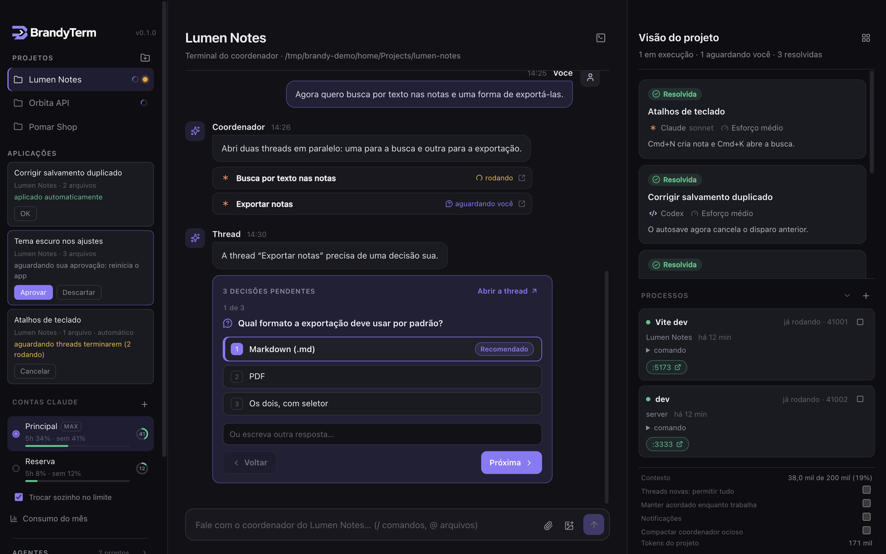
</p>
-->

<!-- Missing screenshot: add docs/assets/screenshot-coordinator.png, then remove these comment markers.
**Coordinator. A request delegated to Claude Code and Codex threads.**

<p align="center">
  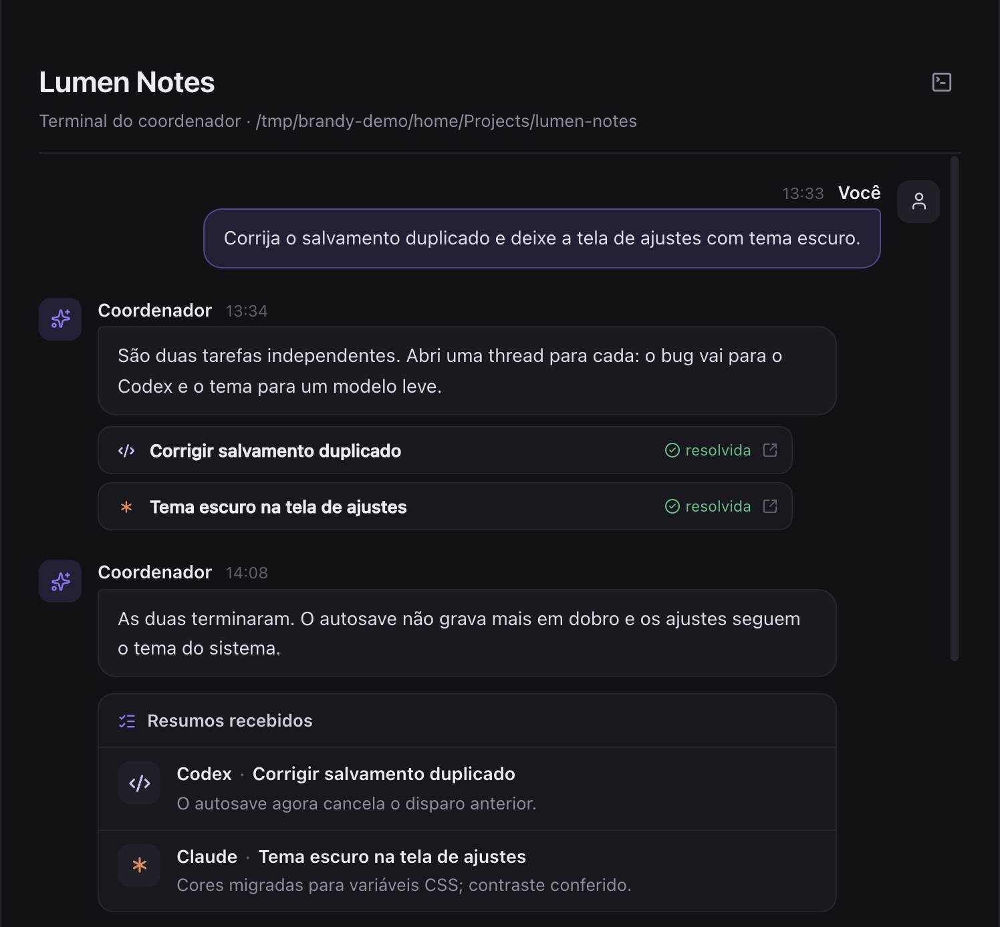
</p>
-->

<!-- Missing screenshot: add docs/assets/screenshot-questions.png, then remove these comment markers.
**Thread questions. One decision at a time, with a recommended option.**

<p align="center">
  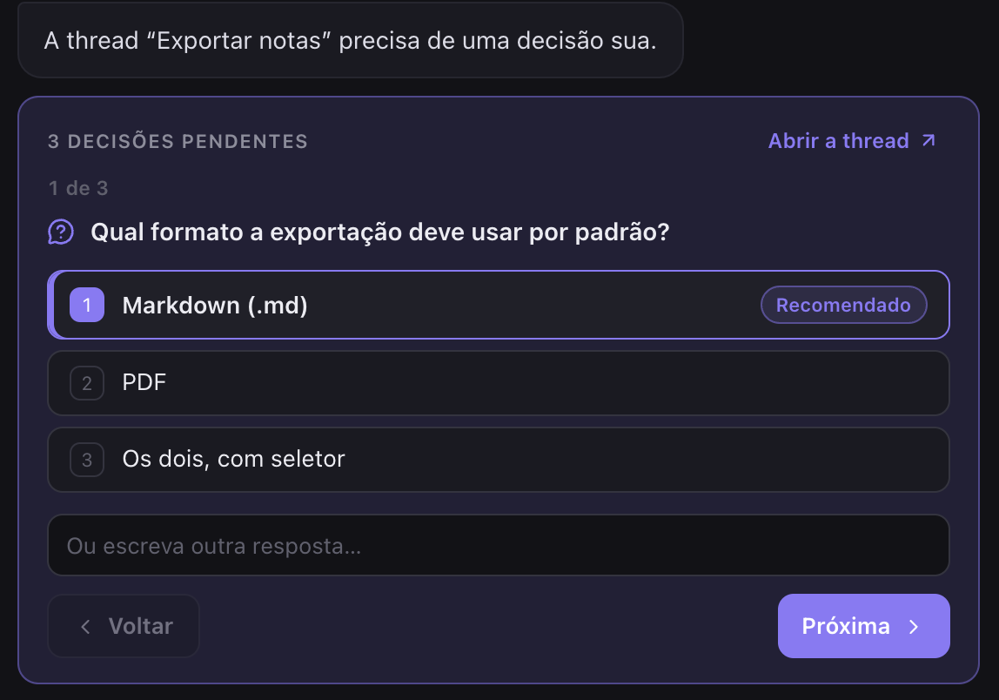
</p>
-->

<!-- Missing screenshot: add docs/assets/screenshot-apply-queue.png, then remove these comment markers.
**Apply queue. Worktree changes waiting for approval or their turn.**

<p align="center">
  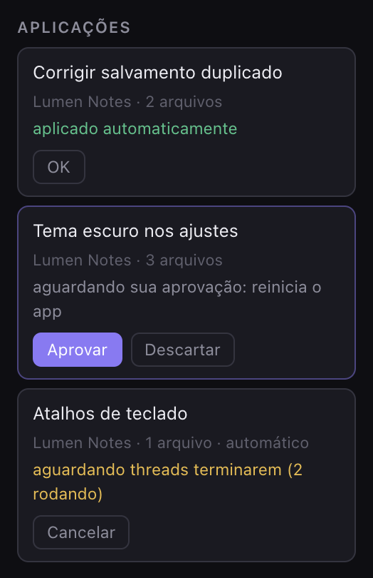
</p>
-->

<!-- Missing screenshot: add docs/assets/screenshot-processes.png, then remove these comment markers.
**Process panel. Running processes with origin, ports and a stop button.**

<p align="center">
  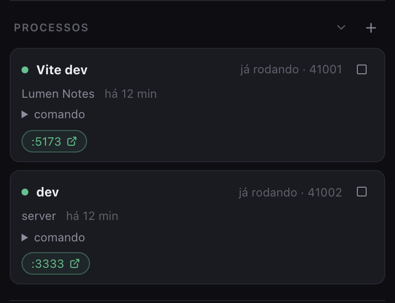
</p>
-->

<!-- Missing screenshot: add docs/assets/screenshot-logs.png, then remove these comment markers.
**View logs. A short summary above the searchable log.**

<p align="center">
  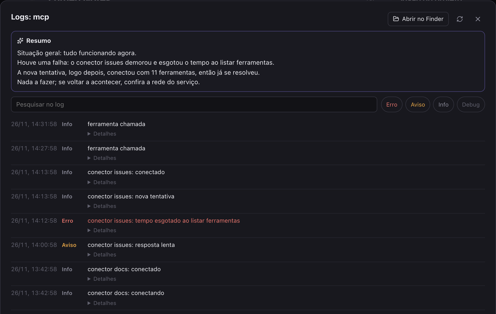
</p>
-->

The screenshots use a demo project with fake data. A demo GIF is coming; see [`docs/assets/README.md`](docs/assets/README.md).

## Requirements

- **macOS or Windows.** BrandyTerm is developed and used on macOS. Windows is covered by CI (typecheck, tests and build); notifications, the process panel, the right-click menu, Codex plugins and the logs window have not been tested by hand there yet (see [Run on Windows](#run-on-windows)).
- **Node.js 22+** and npm.
- **Git**, used on `npm install` to fetch the bundled Claude plugins.
- At least one agent CLI, installed and logged in:
  - **[Claude Code CLI](https://docs.anthropic.com/en/docs/claude-code)** (`claude`). Run `claude` once and log in.
  - **[Codex CLI](https://github.com/openai/codex)** (`codex`). Run `codex` once and log in.

Antigravity (`agy`) is detected but not wired yet.

## Install and run

```bash
git clone https://github.com/ebrandes/brandyTerm.git
cd brandyTerm
npm install          # also runs postinstall: fetches the pinned Claude plugins into resources/plugins
npm run dev          # starts the app in development mode (predev updates the Claude Agent SDK)
```

Other scripts from `package.json`:

| Command | What it does |
| --- | --- |
| `npm run build` | Builds main, preload and renderer into `out/` with electron-vite |
| `npm run preview` | Runs the built app from `out/` |
| `npm run typecheck` | Type-checks the whole project (`tsc --noEmit`) |
| `npm test` | Runs the tests with the Node.js test runner |
| `npm run dev:second` | Starts a second development instance with its own data folder (macOS/Linux shell syntax) |
| `npm run plugins` | Fetches the pinned Claude plugins again |

App state (projects, threads, settings, attachments and the thread archive) lives in the Electron user data folder, `~/Library/Application Support/brandyterm` on macOS and `%APPDATA%\brandyterm` on Windows.

## Run on Windows

CI runs typecheck, tests and build on Windows for pushes to `main` and `feat/**` and for pull requests. To use the app:

```powershell
git clone https://github.com/ebrandes/brandyTerm.git
cd brandyTerm
npm ci
npm run dev
```

Node.js and Git must be on PATH, and the agent CLI (`claude` and/or `codex`) installed and logged in. When **Acesso remoto** (remote access) is on, Windows shows a firewall prompt the first time: allow access on **private networks**.

## Architecture

BrandyTerm is a standard Electron app built with [electron-vite](https://electron-vite.org):

- **`src/main`** (main process, Node.js). The **engine** (`engine.ts`) runs the coordinator, queues and settles threads, and keeps the state. **Adapters** (`src/main/adapters/`) give every agent the same interface: `claude` (Claude Agent SDK, with `canUseTool` for approvals), `codex` (`codex exec --json`) and an `antigravity` stub. Around them: approvals and allow rules, project memory, the router, attachments, the archive, the terminal (node-pty), the process panel, the apply queue, MCP connectors and their gateway, notifications, usage reports and the update check.
- **`src/preload`**. A small `contextBridge` API (`window.brandy`) over IPC. The renderer has no direct Node access.
- **`src/renderer`** (React 18). Chat, composer with `@` and `/` menus, thread view, kanban board, approval cards, terminal (xterm.js), and the process, apply queue, connector and account panels.
- **`src/shared`**. Types and the API contract shared by both sides.

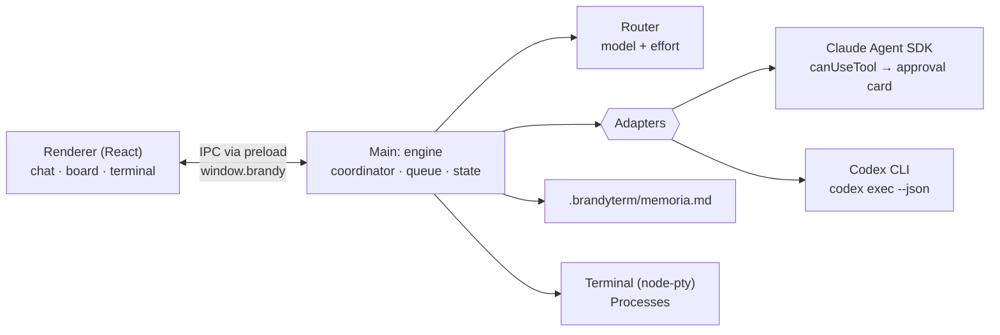

## Roadmap

- [ ] **Packaged app**: `.app`/`.dmg` builds with electron-builder, using the icon in `build/` (`icon.icns`).
- [ ] **Antigravity** adapter (`agy` headless).
- [ ] **Archive follow-ups**: open archived threads from chat chips, run retention while the app is open (today it runs at startup).
- [ ] **SQLite state** instead of a single JSON file.
- [ ] **English UI**.
- [ ] **Hands-on testing on Windows**.

Ideas and votes are welcome in [issues](https://github.com/ebrandes/brandyTerm/issues).

## Contributing

Contributions are welcome.

1. Open an issue first for anything bigger than a small fix, so we can agree on the approach.
2. Fork, create a branch from `main`, and keep changes focused.
3. Run `npm run typecheck` and `npm test` before opening a pull request.
4. Keep source files under 400 lines: split by responsibility instead of growing a file.
5. Never commit tokens, personal paths or screenshots with private data.

## License

[MIT](LICENSE) © BrandyTerm contributors.

BrandyTerm is an independent project and is not affiliated with Anthropic or OpenAI. Claude, Claude Code and Codex are trademarks of their respective owners.

## Support

<p align="center">
  <br>
  <strong>If BrandyTerm saves you time, please <a href="https://github.com/ebrandes/brandyTerm">⭐ star this repo</a>.</strong><br>
  It helps other developers find it.
</p>

<p align="center">
  <a href="https://www.buymeacoffee.com/ebrandes"></a>
</p>

<a href="https://star-history.com/#ebrandes/brandyTerm&Date">
  <picture>
    <source media="(prefers-color-scheme: dark)" srcset="https://api.star-history.com/svg?repos=ebrandes/brandyTerm&type=Date&theme=dark">
    
  </picture>
</a>
