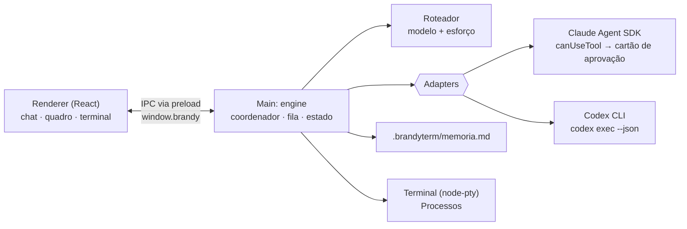

<p align="center">
  
</p>

<h1 align="center">BrandyTerm</h1>

<p align="center">
  <strong>Um terminal desktop para orquestrar vários agentes de IA de programação.</strong><br>
  Rode o <strong>Claude Code</strong> e o <strong>Codex</strong> lado a lado: um coordenador por projeto delega o trabalho a threads de agentes,
  acompanha tudo num quadro kanban e pede sua aprovação antes de qualquer ação arriscada. Feito com Electron, React e TypeScript.
</p>

<p align="center">
  <a href="README.md">English</a> · <strong>Português (Brasil)</strong>
</p>

<p align="center">
  <a href="LICENSE"></a>
  
  
  
  <a href="https://github.com/ebrandes/brandyTerm/stargazers"></a>
</p>

<p align="center">
  
</p>

> **Versão inicial (0.1).** A interface está em português do Brasil. Espere arestas.

## Sumário

- [Funcionalidades](#funcionalidades)
- [Capturas de tela](#capturas-de-tela)
- [Requisitos](#requisitos)
- [Instalar e rodar](#instalar-e-rodar)
- [Arquitetura](#arquitetura)
- [Roadmap](#roadmap)
- [Como contribuir](#como-contribuir)
- [Licença](#licença)
- [Apoie](#apoie)

## Funcionalidades

**Coordenador e threads de agentes**

- **Um chat de coordenador por projeto.** Abra qualquer pasta como projeto. O coordenador responde direto ou divide o pedido em até 3 tarefas, escolhendo agente, modelo e esforço de cada uma e explicando o motivo. Ele só planeja com as CLIs que estão de fato instaladas.
- **Threads de agentes.** Cada tarefa delegada roda numa thread com plano ao vivo (lista de tarefas), ações recolhíveis e uma resposta final curta, que volta para o chat principal. Você também pode abrir uma thread e conversar com ela direto.
- **Roteamento automático de modelo.** Uma chamada rápida de classificação coloca cada tarefa num nível leve, padrão ou pesado, que define o modelo e o esforço.
- **Limites de concorrência e de contexto.** Até 2 threads rodam ao mesmo tempo por projeto; as outras esperam na fila. O contexto da thread é compactado sozinho em 120 mil tokens.
- **Memória do projeto.** Cada projeto mantém um `.brandyterm/memoria.md` curto com contexto, decisões e um mapa do código. O coordenador lê a cada mensagem e as threads leem antes de começar; quando cresce, é compactado automaticamente.

**Controle e segurança**

- **Aprovação antes de ações arriscadas.** As threads do Claude rodam pelo Claude Agent SDK. Ferramentas só de leitura já vêm liberadas; o resto (um comando que altera algo, a edição de um arquivo, acesso à web) para e mostra um cartão de aprovação. Permita uma vez, sempre para aquela família de comandos, ou tudo naquela thread.
- **Perguntas como cartões.** Quando uma thread precisa de uma decisão, ela vai para *Aguardando você* e mostra as opções num cartão no chat principal. Responder ali, ou dizer ao coordenador, retoma a thread.
- **Codex em sandbox.** As threads do Codex rodam `codex exec` com o sandbox dele: escrita só dentro da pasta do projeto e sem rede.
- **Sem flags de bypass.** Os prompts vão por stdin, seus hooks e servidores MCP globais do Claude ficam fora das threads, e os plugins são verificados antes de carregar.

**Espaço de trabalho**

- **Quadro kanban dos agentes.** Colunas *Em fila*, *Em execução*, *Aguardando você*, *Concluídas* e *Falhas e canceladas*. As colunas finais mostram os 10 cartões mais recentes, com *Mostrar mais*; threads com mais de 7 dias, ou além das 50 mais recentes por projeto, vão para um arquivo morto que pode ser reaberto. Nada é apagado.
- **Anexos.** Cole, arraste ou escolha até 12 arquivos (25 MB cada). Imagens podem ser marcadas antes do envio (caneta, caixa, seta, marcadores numerados) e vão tanto para o Claude quanto para o Codex.
- **Menções de arquivo com `@` e comandos com `/`.** Digite `@` para autocompletar arquivos do projeto (respeita o `.gitignore`). Digite `/` para `/clear`, `/compact`, `/help` e os comandos dos seus plugins do Claude.
- **Terminal integrado.** Um shell de verdade por projeto (xterm.js + node-pty), aberto na pasta do projeto.
- **Painel de processos.** Inicie servidores de desenvolvimento e outros comandos longos pela interface. As portas que aparecem na saída viram chips clicáveis, os logs ficam guardados e tudo é encerrado quando o app fecha. Threads nunca iniciam processos.
- **Várias contas do Claude.** Adicione contas extras com `claude setup-token`; os tokens ficam criptografados no chaveiro do sistema. O BrandyTerm pode trocar de conta sozinho antes que um limite de uso interrompa uma execução.
- **Plugins e skills do Claude.** Alguns plugins fixados num commit são baixados na instalação ([Superpowers](https://github.com/obra/superpowers), [TokenEconomizer](https://github.com/microsoft/TokenEconomizer) e dois de [anthropics/claude-plugins-official](https://github.com/anthropics/claude-plugins-official)). Suas próprias skills e plugins do Claude Code podem ser ligados pela barra lateral. O suporte opcional ao [RTK](https://github.com/rtk-ai/rtk) comprime a saída do shell para as threads.
- **Rodapé de tokens e contexto.** Mostra o uso de contexto do coordenador e os tokens gastos no projeto.

## Capturas de tela

**Quadro kanban de agentes.** Todas as threads do projeto, por estado: em fila, em execução, aguardando você, concluídas, falhas ou canceladas.

<p align="center">
  
</p>

**Thread de agente com card de aprovação.** O plano da thread, as ações e um comando de shell esperando sua aprovação.

<p align="center">
  
</p>

**Chat do coordenador.** O coordenador divide o pedido em threads, explica a escolha de agente e modelo e traz a pergunta de uma thread como card.

<p align="center">
  
</p>

As capturas usam um projeto de demonstração com dados fictícios. Um GIF de demonstração está a caminho; veja [`docs/assets/README.md`](docs/assets/README.md).

## Requisitos

- **macOS.** É onde o BrandyTerm é desenvolvido e testado. Existem alguns caminhos de código para Windows (shell e processos), mas o Windows ainda não é suportado.
- **Node.js 22+** e npm.
- **Git**, usado no `npm install` para baixar os plugins do Claude que acompanham o app.
- Pelo menos uma CLI de agente, instalada e com login feito:
  - **[Claude Code CLI](https://docs.anthropic.com/en/docs/claude-code)** (`claude`). Rode `claude` uma vez e faça login.
  - **[Codex CLI](https://github.com/openai/codex)** (`codex`). Rode `codex` uma vez e faça login.

O Antigravity (`agy`) é detectado, mas ainda não está ligado.

## Instalar e rodar

```bash
git clone https://github.com/ebrandes/brandyTerm.git
cd brandyTerm
npm install          # também roda o postinstall: baixa os plugins do Claude fixados para resources/plugins
npm run dev          # abre o app em modo de desenvolvimento (o predev atualiza o Claude Agent SDK)
```

Outros scripts do `package.json`:

| Comando | O que faz |
| --- | --- |
| `npm run build` | Gera main, preload e renderer em `out/` com o electron-vite |
| `npm run preview` | Roda o app gerado em `out/` |
| `npm run typecheck` | Verifica os tipos do projeto inteiro (`tsc --noEmit`) |
| `npm run plugins` | Baixa de novo os plugins do Claude fixados |

O estado do app (projetos, threads, configurações, anexos e o arquivo morto) fica na pasta de dados do Electron, `~/Library/Application Support/brandyterm` no macOS.

## Arquitetura

O BrandyTerm é um app Electron padrão, feito com o [electron-vite](https://electron-vite.org):

- **`src/main`** (processo principal, Node.js). O **engine** (`engine.ts`) roda o coordenador, enfileira e finaliza threads e guarda o estado. Os **adapters** (`src/main/adapters/`) dão a mesma interface a todo agente: `claude` (Claude Agent SDK, com `canUseTool` para as aprovações), `codex` (`codex exec --json`) e um esboço do `antigravity`. Em volta deles: aprovações e regras de permissão, memória do projeto, o roteador, anexos, o arquivo morto, o terminal (node-pty) e o painel de processos.
- **`src/preload`**. Uma API pequena via `contextBridge` (`window.brandy`) sobre IPC. O renderer não tem acesso direto ao Node.
- **`src/renderer`** (React 18). Chat, compositor com os menus de `@` e `/`, visão da thread, quadro kanban, cartões de aprovação, terminal (xterm.js) e os painéis de processos e de contas.
- **`src/shared`**. Tipos e o contrato da API usados pelos dois lados.



## Roadmap

- [ ] **App empacotado**: builds `.app`/`.dmg` com o electron-builder, usando o ícone de `build/` (`icon.icns`).
- [ ] **Adapter do Antigravity** (`agy` em modo headless).
- [ ] **Plano nas threads do Codex**: o `codex exec` não emite plano, então por enquanto as threads do Codex mostram só as ações.
- [ ] **Melhorias no arquivo morto**: abrir threads arquivadas pelos chips do chat e rodar a retenção com o app aberto (hoje roda só na inicialização).
- [ ] **Estado em SQLite** no lugar de um único arquivo JSON.
- [ ] **Interface em inglês** e suporte ao Windows.

Ideias e votos são bem-vindos nas [issues](https://github.com/ebrandes/brandyTerm/issues).

## Como contribuir

Contribuições são bem-vindas.

1. Para qualquer coisa maior que uma correção pequena, abra uma issue antes, para combinarmos a abordagem.
2. Faça um fork, crie um branch a partir do `main` e mantenha as mudanças focadas.
3. Rode `npm run typecheck` antes de abrir o pull request.
4. Mantenha os arquivos de código abaixo de 400 linhas: divida por responsabilidade em vez de engordar um arquivo.
5. Nunca faça commit de tokens, caminhos pessoais ou capturas com dados privados.

## Licença

[MIT](LICENSE) © BrandyTerm contributors.

O BrandyTerm é um projeto independente, sem vínculo com a Anthropic ou a OpenAI. Claude, Claude Code e Codex são marcas de seus respectivos donos.

## Apoie

<p align="center">
  <br>
  <strong>Se o BrandyTerm economiza seu tempo, <a href="https://github.com/ebrandes/brandyTerm">⭐ dê uma estrela ao repositório</a>.</strong><br>
  Isso ajuda outras pessoas a encontrá-lo.
</p>

<p align="center">
  <a href="https://www.buymeacoffee.com/ebrandes"></a>
</p>

<a href="https://star-history.com/#ebrandes/brandyTerm&Date">
  <picture>
    <source media="(prefers-color-scheme: dark)" srcset="https://api.star-history.com/svg?repos=ebrandes/brandyTerm&type=Date&theme=dark">
    
  </picture>
</a>
