<p align="center">
  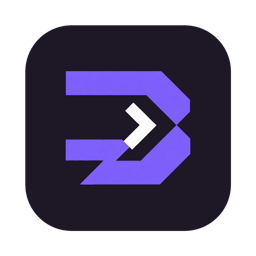
</p>

<h1 align="center">BrandyTerm</h1>

<p align="center">
  <strong>Um terminal desktop para orquestrar vários agentes de IA de programação.</strong><br>
  Rode o <strong>Claude Code</strong> e o <strong>Codex</strong> lado a lado no macOS e no Windows: um coordenador de IA por projeto delega tarefas de programação a threads de agentes,
  acompanha tudo num quadro kanban e pede aprovação antes de ações arriscadas, com conectores MCP e relatórios de consumo de tokens. Feito com Electron, React e TypeScript.
</p>

<p align="center">
  <a href="README.md">English</a> · <strong>Português (Brasil)</strong>
</p>

<p align="center">
  <a href="LICENSE"></a>
  
  
  
  <a href="https://github.com/ebrandes/brandyTerm/stargazers"></a>
</p>

<p align="center">
  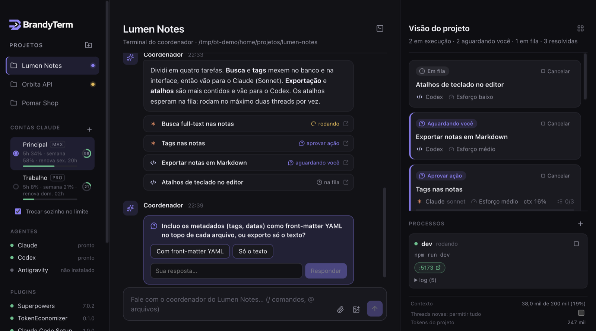
</p>

> **Versão inicial (0.1).** A interface está em português do Brasil. Espere arestas.

## Sumário

- [Funcionalidades](#funcionalidades)
- [Capturas de tela](#capturas-de-tela)
- [Requisitos](#requisitos)
- [Instalar e rodar](#instalar-e-rodar)
- [Arquitetura](#arquitetura)
- [Roadmap](#roadmap)
- [Como contribuir](#como-contribuir)
- [Licença](#licença)
- [Apoie](#apoie)

## Funcionalidades

### Coordenador e threads de agentes

- **Um chat de coordenador por projeto.** Abra qualquer pasta como projeto. O coordenador responde direto ou divide o pedido em até 3 tarefas, escolhendo agente, modelo e esforço de cada uma e explicando o motivo. Ele só planeja com as CLIs que estão de fato instaladas. Também responde uma thread que está esperando, faz perguntas a uma thread, retoma threads interrompidas e resume os resultados no fim.
- **Threads de agentes Claude Code e Codex.** Cada tarefa delegada roda numa thread com plano ao vivo (lista de tarefas), ações recolhíveis e uma resposta final curta, que volta para o chat principal. Você também pode abrir uma thread e conversar com ela direto.
- **Roteamento automático de modelo.** O coordenador indica um nível leve, padrão ou pesado para cada tarefa (uma chamada rápida ao Haiku classifica só quando o nível não vem). No Claude, o nível define o modelo e o esforço, e as tarefas pesadas planejam com um modelo mais forte antes de executar; no Codex, define o esforço. Prefixos como `!haiku`, `!sonnet`, `!opus` ou `!plano` no começo da mensagem trocam a escolha.
- **Limites de concorrência e de contexto.** Até 2 threads rodam ao mesmo tempo por projeto; as outras esperam na fila. O contexto das threads e do coordenador é compactado sozinho, e um coordenador parado com contexto grande pode ser compactado para economizar tokens.
- **Memória do projeto.** Cada projeto mantém um `.brandyterm/memoria.md` curto com contexto, decisões e um mapa do código. O coordenador lê a cada mensagem e as threads leem antes de começar; quando cresce, é compactado automaticamente.

### Perguntas, status e notificações

- **Perguntas das threads com stepper.** Quando uma thread precisa de decisões, ela vai para *Aguardando você* e mostra um cartão na thread e no chat principal. Várias perguntas aparecem uma de cada vez (*1 de N*), com opções clicáveis, a recomendada em destaque e um campo de resposta livre; todas as respostas são enviadas juntas. Responder em qualquer um dos dois lugares, ou dizer ao coordenador, retoma a thread.
- **Status por projeto.** Na barra lateral, um spinner indica que algo está rodando, um ponto âmbar indica que uma thread está esperando você, e um ponto na cor de destaque indica novidade que você ainda não viu. Passe o mouse para ver as contagens.
- **Notificações nativas.** Quando uma thread ou o coordenador termina, falha ou precisa de resposta, chega uma notificação do sistema com o nome do projeto e o título da thread (sem o conteúdo da conversa). Clicar abre aquele lugar. Ela não aparece se você já está olhando para ele, e dá para desligar.

### Controle e segurança

- **Aprovação antes de ações arriscadas.** As threads do Claude rodam pelo Claude Agent SDK. Ferramentas só de leitura já vêm liberadas; o resto (um comando que altera algo, a edição de um arquivo, acesso à web) para e mostra um cartão de aprovação. Permita uma vez, sempre para aquela família de comandos, ou tudo naquela thread. Um ajuste opcional deixa threads novas rodarem sem perguntar; ele vem desligado.
- **Fila de aplicação de worktrees.** Uma thread que trabalhou numa worktree do git pode pedir para aplicar o commit na pasta do projeto. Os pedidos aparecem no painel **Aplicações** da barra lateral. Você aprova cada um uma vez; o BrandyTerm então aplica um por vez, em ordem, quando nada está rodando em nenhum projeto. O patch é fixado no momento do pedido, conferido com `git apply --check`, aplicado por inteiro ou nada e sem fazer commit. Um pedido que falha segura a fila até você tentar de novo ou descartar.
- **Codex em sandbox.** As threads de trabalho do Codex rodam `codex exec` com o sandbox dele: escrita só dentro da pasta do projeto e sem rede.
- **Sem flags de bypass.** Os prompts vão por stdin, seus hooks e servidores MCP globais do Claude ficam fora das threads, e os plugins são verificados antes de carregar.

### Conectores MCP

- **Conectores globais e por projeto.** No painel **Conectores**, você adiciona um servidor MCP uma vez e escolhe onde ele fica ativo: em todos os projetos, inclusive os novos, com exceções, ou só nos projetos marcados. As threads de trabalho do Claude e do Codex chegam a eles por um gateway MCP do BrandyTerm.
- **Modelos prontos e servidores próprios.** Modelos prontos: Railway, GitHub, Stripe, Supabase, Sentry e Chrome DevTools. Qualquer outro servidor entra por URL ou comando, por exemplo o [Context7](https://context7.com) (`https://mcp.context7.com/mcp`). Um comando `claude mcp add` ou `codex mcp add` colado é reconhecido e convertido, e dá para importar do Claude Code.
- **Aprovação e segredos.** Chamadas de ferramentas de conectores feitas pelas threads mostram um cartão de aprovação (negar, uma vez ou sempre para aquela ferramenta), a não ser que já estejam liberadas. Os segredos são criptografados com o chaveiro do sistema.
- **Logs com resumo.** **Ver logs** mostra um resumo curto do log escrito pelo Claude Haiku, com os erros primeiro, além de busca, filtro por nível e um botão para mostrar o arquivo. O resumo só é pedido com a janela aberta; os segredos são ocultados na hora em que as entradas são gravadas.

### Economia de tokens

- **TokenEconomizer e RTK.** O [TokenEconomizer](https://github.com/microsoft/TokenEconomizer) e o suporte opcional ao [RTK](https://github.com/rtk-ai/rtk), que comprime a saída do shell, são passados a cada execução sem mudar suas configurações de usuário. No Codex, exigem Codex CLI 0.171.0 ou mais novo; o TokenEconomizer precisa de Python 3.10+.
- **Relatório “Consumo do mês”.** Mostra a qualidade por nível (concluídas, retrabalho, substituições, correções, escalonamentos, tokens por tarefa resolvida) comparada com o mês anterior; o consumo por projeto, agente, modelo e tipo de chamada (o Codex não informa custo); e a economia por ferramenta, com a estimativa do RTK e a comparação de threads com e sem cada uma. Só chama algo de ganho quando há dados suficientes e a qualidade não piorou.
- **Rodapé de tokens e contexto.** Mostra o uso de contexto do coordenador e os tokens gastos no projeto.

### Espaço de trabalho

- **Quadro kanban dos agentes.** Colunas *Em fila*, *Em execução*, *Aguardando você*, *Concluídas* e *Falhas e canceladas*. As colunas finais mostram os 10 cartões mais recentes, com *Mostrar mais*.
- **Arquivo morto de threads.** Threads finalizadas com mais de 7 dias, ou além das 50 mais recentes por projeto, vão para um arquivo morto que pode ser reaberto. A retenção roda na inicialização e nada é apagado.
- **Painel de processos.** **PROCESSOS** lista os processos detectados e se vieram do terminal, de uma thread ou já estavam rodando, com PID, pasta, tempo no ar, comando completo e portas clicáveis. Filtros escondem o ruído, como o próprio app, os agentes, servidores MCP e hooks. Um botão de parar, com confirmação, encerra o processo e os filhos dele. Também dá para iniciar servidores de desenvolvimento pelo painel; os logs ficam guardados e eles são encerrados quando o app fecha. O painel pode ser minimizado.
- **Menu de clique direito nos projetos.** Renomear (só o nome exibido), arquivar e restaurar, limpar o contexto do coordenador, abrir no Finder ou no Explorador de Arquivos, copiar o caminho ou remover o projeto do BrandyTerm. A pasta nunca é apagada.
- **Anexos.** Cole, arraste ou escolha até 12 arquivos (25 MB cada). Imagens podem ser marcadas antes do envio (caneta, caixa, seta, marcadores numerados) e vão tanto para o Claude quanto para o Codex.
- **Menções de arquivo com `@` e comandos com `/`.** Digite `@` para autocompletar arquivos do projeto (respeita o `.gitignore`). Digite `/` para `/clear`, `/compact`, `/help` e os comandos dos seus plugins do Claude.
- **Terminal integrado.** Um shell de verdade por projeto (xterm.js + node-pty), aberto na pasta do projeto.
- **Várias contas do Claude.** Adicione contas extras com `claude setup-token`; os tokens ficam criptografados no chaveiro do sistema. O BrandyTerm pode trocar de conta sozinho antes que um limite de uso interrompa uma execução.
- **Plugins e skills do Claude.** Alguns plugins fixados num commit são baixados na instalação ([Superpowers](https://github.com/obra/superpowers), [TokenEconomizer](https://github.com/microsoft/TokenEconomizer) e dois de [anthropics/claude-plugins-official](https://github.com/anthropics/claude-plugins-official)). Cada projeto escolhe suas skills e plugins no painel Skills da barra lateral; a escolha fica em `.brandyterm/skills.json` e viaja com o git do projeto. `/skill-init`, `/skill-refresh` e `/skill-install` sugerem, atualizam e importam itens de uma biblioteca de skills (um repositório git, `ebrandes/claude-kit` por padrão, trocado no rodapé do painel).
- **Acesso remoto na rede local.** Vem desligado. Pareie outros computadores e escolha quais projetos ficam disponíveis para eles.
- **Versão e aviso de atualização.** A versão aparece ao lado do logo. O BrandyTerm verifica na abertura e a cada 6 horas se há uma release mais nova no GitHub ou, num clone git, commits novos no `origin/main`. Ele nunca instala nada: abre a página da release ou mostra o comando `git pull` para copiar.

## Capturas de tela

**Quadro kanban de agentes.** Todas as threads do projeto, por estado: em fila, em execução, aguardando você, concluídas, falhas ou canceladas.

<p align="center">
  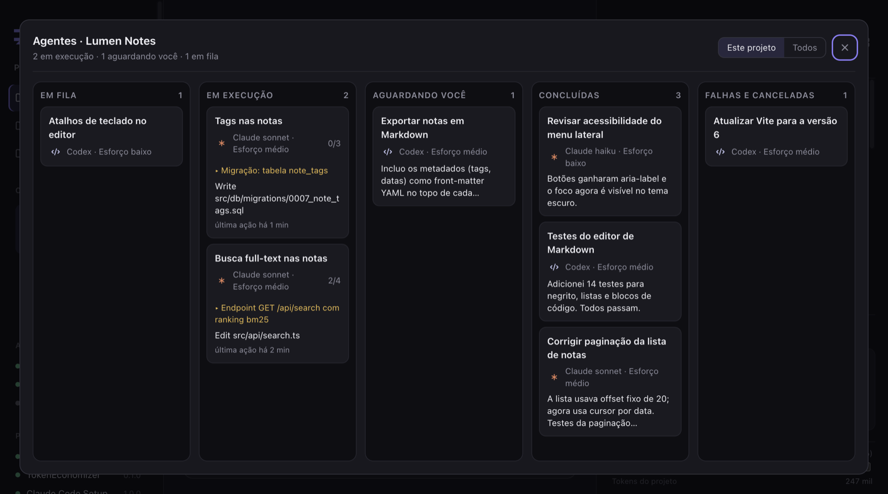
</p>

**Thread de agente com card de aprovação.** O plano da thread, as ações e um comando de shell esperando sua aprovação.

<p align="center">
  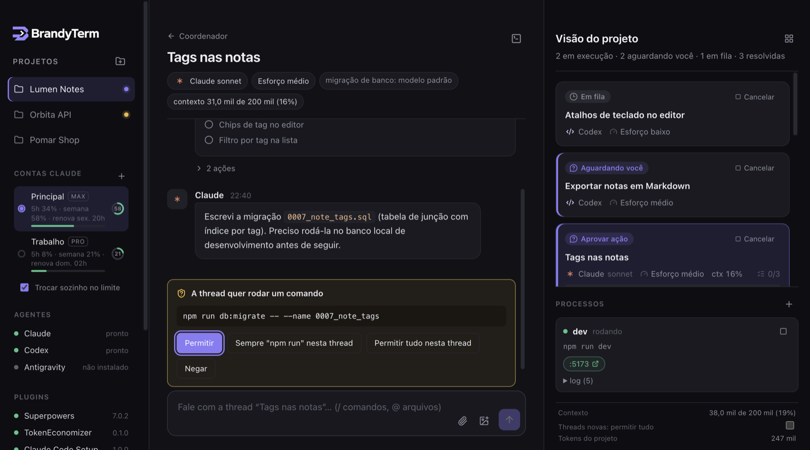
</p>

**Chat do coordenador.** O coordenador divide o pedido em threads, explica a escolha de agente e modelo e traz a pergunta de uma thread como card.

<p align="center">
  
</p>

<!-- Captura pendente: adicione docs/assets/screenshot-overview.png e remova as marcas deste comentário.
**Visão geral. Projetos com status, o chat do coordenador e a visão do projeto.**

<p align="center">
  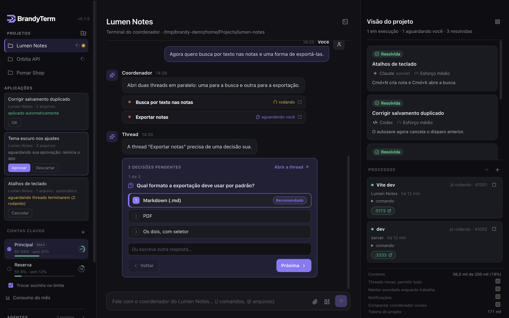
</p>
-->

<!-- Captura pendente: adicione docs/assets/screenshot-coordinator.png e remova as marcas deste comentário.
**Coordenador. Um pedido delegado a threads do Claude Code e do Codex.**

<p align="center">
  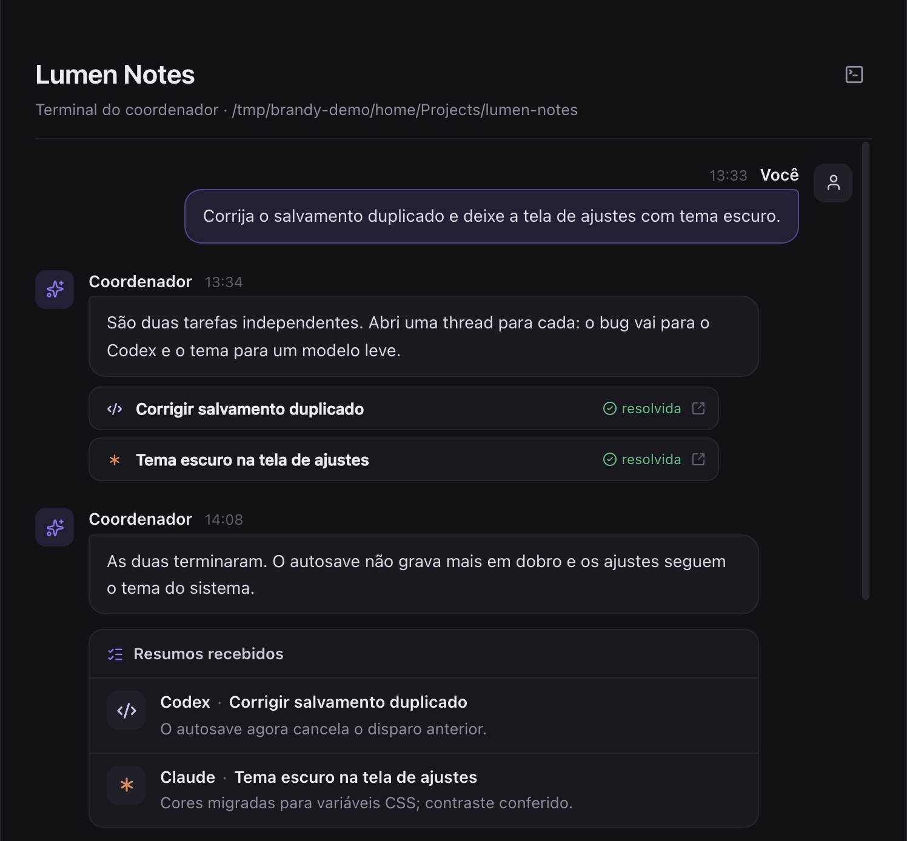
</p>
-->

<!-- Captura pendente: adicione docs/assets/screenshot-questions.png e remova as marcas deste comentário.
**Perguntas das threads. Uma decisão por vez, com opção recomendada.**

<p align="center">
  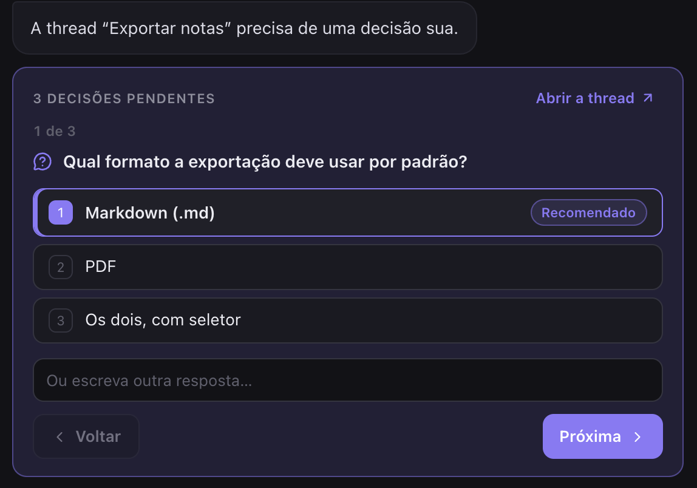
</p>
-->

<!-- Captura pendente: adicione docs/assets/screenshot-apply-queue.png e remova as marcas deste comentário.
**Aplicações. Mudanças de worktrees esperando aprovação ou a vez.**

<p align="center">
  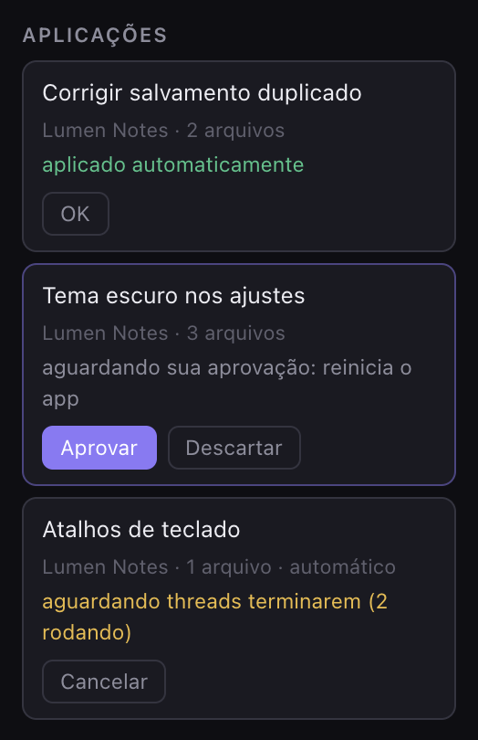
</p>
-->

<!-- Captura pendente: adicione docs/assets/screenshot-processes.png e remova as marcas deste comentário.
**PROCESSOS. Processos rodando com origem, portas e botão de parar.**

<p align="center">
  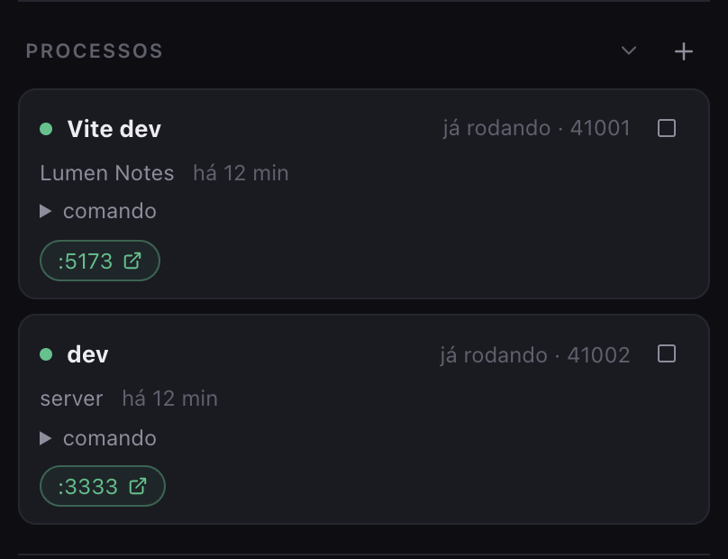
</p>
-->

<!-- Captura pendente: adicione docs/assets/screenshot-logs.png e remova as marcas deste comentário.
**Ver logs. Um resumo curto acima do log pesquisável.**

<p align="center">
  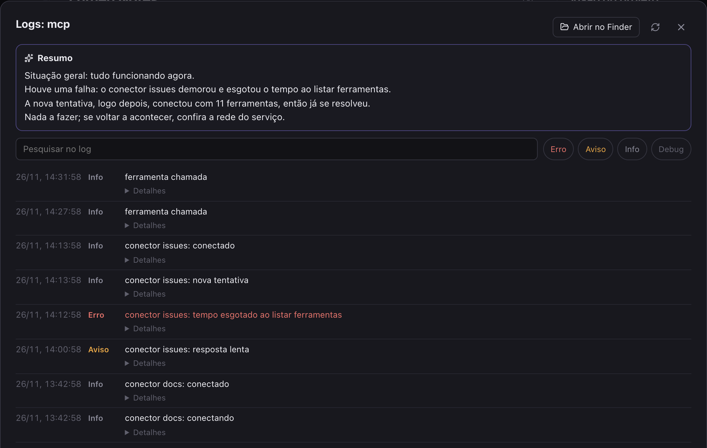
</p>
-->

As capturas usam um projeto de demonstração com dados fictícios. Um GIF de demonstração está a caminho; veja [`docs/assets/README.md`](docs/assets/README.md).

## Requisitos

- **macOS ou Windows.** O BrandyTerm é desenvolvido e usado no macOS. O Windows é coberto pelo CI (typecheck, testes e build); notificações, o painel de processos, o menu de clique direito, os plugins do Codex e a janela de logs ainda não foram testados à mão nele (veja [Rodar no Windows](#rodar-no-windows)).
- **Node.js 22+** e npm.
- **Git**, usado no `npm install` para baixar os plugins do Claude que acompanham o app.
- Pelo menos uma CLI de agente, instalada e com login feito:
  - **[Claude Code CLI](https://docs.anthropic.com/en/docs/claude-code)** (`claude`). Rode `claude` uma vez e faça login.
  - **[Codex CLI](https://github.com/openai/codex)** (`codex`). Rode `codex` uma vez e faça login.

O Antigravity (`agy`) é detectado, mas ainda não está ligado.

## Instalar e rodar

```bash
git clone https://github.com/ebrandes/brandyTerm.git
cd brandyTerm
npm install          # também roda o postinstall: baixa os plugins do Claude fixados para resources/plugins
npm run dev          # abre o app em modo de desenvolvimento (o predev atualiza o Claude Agent SDK)
```

Outros scripts do `package.json`:

| Comando | O que faz |
| --- | --- |
| `npm run build` | Gera main, preload e renderer em `out/` com o electron-vite |
| `npm run preview` | Roda o app gerado em `out/` |
| `npm run typecheck` | Verifica os tipos do projeto inteiro (`tsc --noEmit`) |
| `npm test` | Roda os testes com o test runner do Node.js |
| `npm run dev:second` | Abre uma segunda instância de desenvolvimento com pasta de dados própria (sintaxe de shell do macOS/Linux) |
| `npm run plugins` | Baixa de novo os plugins do Claude fixados |

O estado do app (projetos, threads, configurações, anexos e o arquivo morto) fica na pasta de dados do Electron, `~/Library/Application Support/brandyterm` no macOS e `%APPDATA%\brandyterm` no Windows.

## Rodar no Windows

O CI roda typecheck, testes e build no Windows nos pushes para `main` e `feat/**` e nos pull requests. Para usar o app:

```powershell
git clone https://github.com/ebrandes/brandyTerm.git
cd brandyTerm
npm ci
npm run dev
```

Precisa de Node.js e Git no PATH, e da CLI do agente (`claude` e/ou `codex`) instalada e com login feito. Com **Acesso remoto** ligado, o Windows mostra um aviso do firewall na primeira vez: permita o acesso em **redes privadas**.

## Arquitetura

O BrandyTerm é um app Electron padrão, feito com o [electron-vite](https://electron-vite.org):

- **`src/main`** (processo principal, Node.js). O **engine** (`engine.ts`) roda o coordenador, enfileira e finaliza threads e guarda o estado. Os **adapters** (`src/main/adapters/`) dão a mesma interface a todo agente: `claude` (Claude Agent SDK, com `canUseTool` para as aprovações), `codex` (`codex exec --json`) e um esboço do `antigravity`. Em volta deles: aprovações e regras de permissão, memória do projeto, o roteador, anexos, o arquivo morto, o terminal (node-pty), o painel de processos, a fila de aplicações, os conectores MCP e o gateway deles, as notificações, os relatórios de consumo e a checagem de atualização.
- **`src/preload`**. Uma API pequena via `contextBridge` (`window.brandy`) sobre IPC. O renderer não tem acesso direto ao Node.
- **`src/renderer`** (React 18). Chat, compositor com os menus de `@` e `/`, visão da thread, quadro kanban, cartões de aprovação, terminal (xterm.js) e os painéis de processos, aplicações, conectores e contas.
- **`src/shared`**. Tipos e o contrato da API usados pelos dois lados.

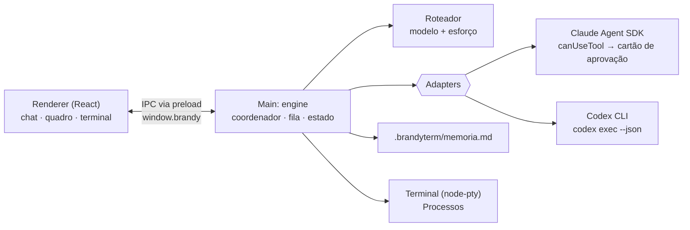

## Roadmap

- [ ] **App empacotado**: builds `.app`/`.dmg` com o electron-builder, usando o ícone de `build/` (`icon.icns`).
- [ ] **Adapter do Antigravity** (`agy` em modo headless).
- [ ] **Melhorias no arquivo morto**: abrir threads arquivadas pelos chips do chat e rodar a retenção com o app aberto (hoje roda só na inicialização).
- [ ] **Estado em SQLite** no lugar de um único arquivo JSON.
- [ ] **Interface em inglês**.
- [ ] **Testes manuais no Windows**.

Ideias e votos são bem-vindos nas [issues](https://github.com/ebrandes/brandyTerm/issues).

## Como contribuir

Contribuições são bem-vindas.

1. Para qualquer coisa maior que uma correção pequena, abra uma issue antes, para combinarmos a abordagem.
2. Faça um fork, crie um branch a partir do `main` e mantenha as mudanças focadas.
3. Rode `npm run typecheck` e `npm test` antes de abrir o pull request.
4. Mantenha os arquivos de código abaixo de 400 linhas: divida por responsabilidade em vez de engordar um arquivo.
5. Nunca faça commit de tokens, caminhos pessoais ou capturas com dados privados.

## Licença

[MIT](LICENSE) © BrandyTerm contributors.

O BrandyTerm é um projeto independente, sem vínculo com a Anthropic ou a OpenAI. Claude, Claude Code e Codex são marcas de seus respectivos donos.

## Apoie

<p align="center">
  <br>
  <strong>Se o BrandyTerm economiza seu tempo, <a href="https://github.com/ebrandes/brandyTerm">⭐ dê uma estrela ao repositório</a>.</strong><br>
  Isso ajuda outras pessoas a encontrá-lo.
</p>

<p align="center">
  <a href="https://www.buymeacoffee.com/ebrandes"></a>
</p>

<a href="https://star-history.com/#ebrandes/brandyTerm&Date">
  <picture>
    <source media="(prefers-color-scheme: dark)" srcset="https://api.star-history.com/svg?repos=ebrandes/brandyTerm&type=Date&theme=dark">
    
  </picture>
</a>
